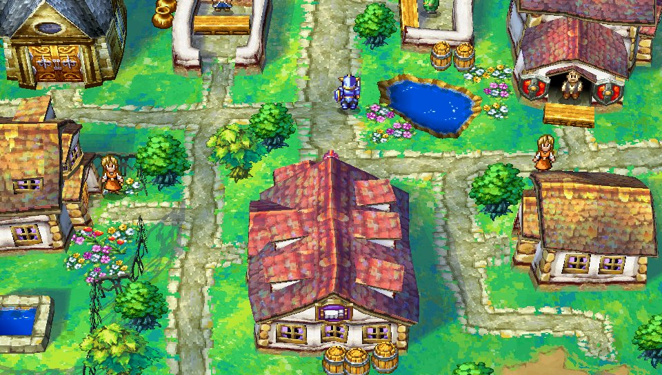

# Dragon Quest IV Vita

<p align="center">
  
</p>

[](https://github.com/frangarcj/dqiv_vita/actions/workflows/compilation.yml)

A port of *Dragon Quest IV: Chapters of the Chosen (Android)* for the **PlayStation Vita**, based on the original ARMv7 game. Like [FF3 Vita](https://github.com/frangarcj/ff3_vita) and [FF6 Vita](https://github.com/frangarcj/ff6_vita), it loads the Android game files instead of including them in the download. Everything the Unity engine did is reimplemented natively. You'll need your own copy of the game.

**Download:** [dqivn.vpk (v1.0.0-rc1)](https://github.com/frangarcj/dqiv_vita/releases/download/v1.0.0-rc1/dqivn.vpk)

## Installation

1. Install [kubridge](https://github.com/bythos14/kubridge/releases/) and [FdFix](https://github.com/TheOfficialFloW/FdFix/releases/) in your Vita's active taiHEN plugins folder. Add them under `*KERNEL` in `config.txt`, adjusting the paths if necessary:

   ```text
   *KERNEL
   ux0:tai/kubridge.skprx
   ux0:tai/fd_fix.skprx
   ```

   **Note:** If you already use rePatch, don't install FdFix.

2. Install `libshacccg.suprx` if you don't have it yet. Follow [this guide](https://samilops2.gitbook.io/vita-troubleshooting-guide/shader-compiler/extract-libshacccg.suprx).

3. Get the **Google Play v1.0.5** version of Dragon Quest IV from your own legally obtained copy, including its APK and OBB. Other versions are refused by the converter.

   | File | Version | MD5 |
   | --- | --- | --- |
   | APK (`com.square_enix.android_googleplay.dq4`) | v1.0.5 | `2f0bcb22598a16ce50a038488696bc98` |
   | `main.106.com.square_enix.android_googleplay.dq4.obb` | main.106 | `3d27a44d87f30f119fa4a7d73805c4b7` |

   The OBB is in `/sdcard/Android/obb/com.square_enix.android_googleplay.dq4/` on your phone. You can extract the APK with any APK extractor app or with `adb`.

4. Convert your files with the **[web converter](https://frangarcj.github.io/dqiv_vita/)**: open it in a modern browser, select the APK and the OBB, choose the language and screen layout, and press **Convert**. Everything runs locally in your browser, so your files are never uploaded. Chrome and Edge can write straight to a folder; Firefox and Safari download a ZIP.

   If you prefer the command line, [make_data.py](tools/make_data.py) produces the same result. It needs Python 3.10 or newer and about 2 GB of free RAM:

   ```bash
   python3 tools/make_data.py DQ4.apk main.106.com.square_enix.android_googleplay.dq4.obb dqiv_data
   ```

5. Copy the contents of the converted folder to `ux0:data/dqiv/` on your Vita. It's about 380 MB in total.

6. Install **dqivn.vpk** on your Vita and launch the game. The first launch takes a little longer.

Your saves are stored in `ux0:data/dqiv/saves1/`. Back them up before updating, but **don't delete the folder** when installing a new VPK.

## Configuration

Edit `ux0:data/dqiv/config.txt` to change the settings, one `key=value` per line:

| Key | Values | Meaning |
| --- | --- | --- |
| `lang` | `en` (default), `ko`, `zh-tw`, `zh-cn` | Game language. This version of the game has no Japanese text. |
| `confirm` | `circle` | Swap Cross and Circle. |
| `layout` | `landscape` (default), `split`, `portrait` | Screen layout. `portrait` restores the original pillar-boxed view. |

Battle, dialogue and other options are listed in the [reference](docs/REFERENCE.md#configtxt).

## Controls

Nothing in the game needs the touch screen, but touch still works as on Android.

| Button | On the map | In menus |
| --- | --- | --- |
| D-pad / left stick | Move | Move the selection |
| Cross | Talk or check | Confirm |
| Circle | Party talk | Cancel |
| Triangle | Command menu | Name entry: shift |
| Square | Area map | Name entry: delete |
| L / R or right stick | Rotate the camera | Name entry: keyboard pages |
| Start | Quit dialog | Name entry: enter |
| Select | On-screen pointer | On-screen pointer |

## Building

You'll need [VitaSDK](https://github.com/vitasdk) and these packages. vitaGL is built from the `lib/vitaGL` submodule:

```bash
vdpm opensles libsndfile lame mpg123 opus libvorbis libogg flac libmathneon vitaShaRK kubridge taihen SceShaccCgExt zlib
git clone --recurse-submodules https://github.com/frangarcj/dqiv_vita.git
cd dqiv_vita
cmake -S . -B build -DCMAKE_BUILD_TYPE=Release
cmake --build build --target dqivn.vpk-vpk -j8
```

The installable package is `build/dqivn.vpk`. You can check it with `python3 tools/check_release.py build`. GitHub Actions also builds the port automatically; see the [CI workflow](.github/workflows/compilation.yml). See [DEVELOPERS.md](DEVELOPERS.md) for the architecture and test tools.

## Credits

- TheFloW for so_util and the original loader.
- gl33ntwine for soloader-boilerplate and FalsoJNI.
- Rinnegatamante for vitaGL and vitaShaRK.
- bythos14 for kubridge.
- K0lb3 for UnityPy, used by the converter.
- The VitaSDK team.

Dragon Quest is a trademark of Square Enix. This project contains no game data. The LiveArea images are generated from the game's launcher icon and remain Square Enix artwork.

This is still a release candidate. It has mostly been tested in the Vita3K emulator; on a real Vita, only the start-up has been checked so far. If you find a bug, please [open an issue](https://github.com/frangarcj/dqiv_vita/issues). See the [reference](docs/REFERENCE.md) for what has been tested, troubleshooting and the remaining options.
