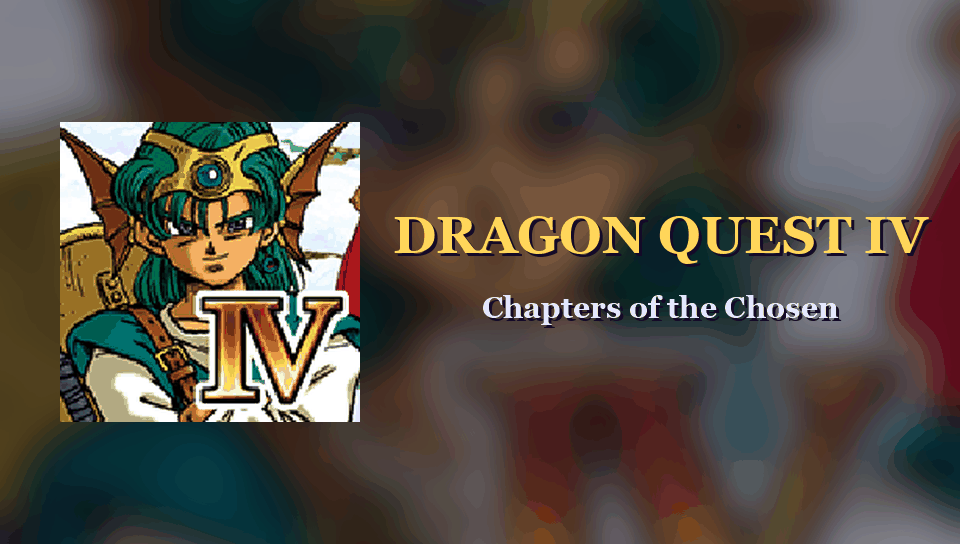

# Dragon Quest IV (PS Vita)

<p align="center"></p>

A native PS Vita port of the Android version of *Dragon Quest IV: Chapters of the Chosen* (Square Enix, v1.0.5). The Android game logic (`libdq4core.so`) and audio engine
(`libsdlib_android.so`) are loaded in memory and run unchanged; everything that Unity did (scenes, sprites, UI, effects) is a C++ re-implementation on top of vitaGL.
**No Unity runtime is involved and no game data is included**: you convert your own copy of the game once, on a PC.

* Four languages: English (default), Korean, Traditional Chinese and Simplified Chinese. **There is no Japanese**: the v1.0.5 OBB holds game text only for `en`, `ko`, `sl` (zh-CN) and `tl` (zh-TW), so `lang=ja` is refused with a log warning.
* Landscape display (the original is portrait-only; `layout=portrait` restores it). Physical controls plus touch, as on Android. Saves are the original format (`data1..5.dat`, `data9.dat`).
* Cloud Save / Google Drive and the online present-code features are not available (the Vita side answers as if the device were offline).

**Status: early.** What was actually checked, in Vita3K unless noted (the logs and screenshots of the development builds; **on a real PS Vita only the start-up was checked: the Release VPK boots through the intro credits to the title menu at 30 FPS, nothing was played there**, and the emulator is muted, so sound was only checked through log lines, never by ear):

* **verified**: both libraries load and link with 0 unresolved imports, `JNI_OnLoad` of both succeeds, the converted pack opens (28 446 objects), the world-map tile patch is applied (`libdq4core` `FieldData::drawBlock`, 59 columns) and the widened world map was seen in play (full 960 px width);
  the title scene (logos, backdrop, start menu with Continue / Create a new adventure log / Delete / Licence / Cloud Save) in landscape with sound running (no underruns in the log).
* **played with the physical buttons only** (no touch): Create a new adventure log -> slot list -> **hero name entry** (type with Cross, Triangle = shift, Square = delete, d-pad to Enter or Start) -> gender -> "Prologue" card -> the prologue basement and the hero's village (the prologue itself is left to the user's play test, see docs/TODO_DQ4.md); Continue from the title (loads the last game);
  from a `chapter 1` warp: the king's cutscene (Cross), the throne hall, Burland town, the exit to the world map and a **random battle fought to victory** with Cross (Fight, Attack, first target, messages); command menu (Items / Magic / Attributes / Misc. with Equipment, Line-up, Organise Items); the **area map** with Square (CityMap with the real Burland picture and its weapon-shop list, WorldLargeMap on the world map); camera rotation with L / R in a town; battle Party > Change One.
  Round 2 (Burland from an `eventinit 6` warp, buttons only, 2-frame d-pad taps included): **talking with Cross** (it did nothing before: a port bug fixed, the DQ4 core only reads the 0x100 tap as the field "A"), **item and weapon stall: buy, equip on purchase, sell, with the gold charged and paid (900G, Oaken club 30G -> 870G, sold for 22G -> 892G)**, **church: Confession (Save) to slot 1 and Continue from the title back into the saved church**, **inn: stay with the night fade and "Good morning"**, entering the church and the inn by their real doors, pushing a pot, talking to a roaming villager, the command menu / Misc. submenu, party talk with the Chapter-5 party, and the sepia map shader forced with the dev cfg `fldsepia=1`.
* **not verified**: **Quick Save** (greyed in the towns tried), opening a chest or a pot with content, the wagon, the prologue (it is left to the user's own play test; it is not tracked as a bug), cutscenes beyond the first one, the staff roll, the Korean and Chinese languages, `layout=split`, performance and memory on a real console. The bank, casino games and the monster arena were only screenshotted or warped.
* the developer cheats and warp harness (`DevCheats`, `WarpTest`, `BattleTest`) work in DQ4 (see "Warp harness and Coverage" below); `layout=portrait` and `battle_layout=band` were seen in a battle, the other battle/dialogue options were carried over from the DQ5 port and not re-checked.

See [DEVELOPERS.md](DEVELOPERS.md) and [docs/TODO_DQ4.md](docs/TODO_DQ4.md) for the details and the open items.

## Setup (end users)

### 1. Vita requirements
* A hacked PS Vita with [taiHEN](https://github.com/yifanlu/taiHEN). Install **kubridge**: copy `kubridge.skprx` ([releases](https://github.com/bythos14/kubridge/releases/)) to `ux0:tai/` and add it under `*KERNEL` in `ux0:tai/config.txt`:
  ```
  *KERNEL
  ux0:tai/kubridge.skprx
  ```
  (reboot afterwards).
* Recommended: [FdFix](https://github.com/TheOfficialFloW/FdFix/releases/), added under `*KERNEL` in the same way, unless you use rePatch (do not install both). The port keeps its data files open while running, and FdFix keeps those file handles valid after the console suspends and resumes.
* `libshacccg.suprx` is **not needed to start the game** as long as `ux0:data/dqiv/cg/*.bin` exists (prepared by step 3): the screen-effect shaders `dqiv_gray` and `dqiv_sepia_fld` are shipped precompiled. The third program (`dqiv_sleep`, the lying-down pose of characters) has no shipped blob: without `libshacccg.suprx` it falls back to a fixed-function approximation (unverified on hardware), with it the game compiles it once and caches it as `ux0:data/dqiv/cg/dqiv_sleep.bin`
  ([how to get libshacccg.suprx](https://samilops2.gitbook.io/vita-troubleshooting-guide/shader-compiler/extract-libshacccg.suprx)).

### 2. Get the game files (legally, from your own purchase)
You need exactly these two files (the script checks their md5):

| file | version | md5 |
|---|---|---|
| `DRAGON QUEST IV` APK | v1.0.5 (`com.square_enix.android_googleplay.dq4`) | `2f0bcb22598a16ce50a038488696bc98` |
| `main.106.com.square_enix.android_googleplay.dq4.obb` | main.106 | `3d27a44d87f30f119fa4a7d73805c4b7` |

These md5s are those of the files the port was developed with. **A different build of the APK, even if it is also called v1.0.5, is refused** by the script (and by the web page, which has no override); `tools/make_data.py ... --skip-md5` lets you try it at your own risk (the Unity assets must then still convert to the same layout; the script warns if the pack differs from the reference).

The OBB is in `/sdcard/Android/obb/com.square_enix.android_googleplay.dq4/` on your phone; the APK can be extracted with any APK extractor app or `adb pull $(adb shell pm path com.square_enix.android_googleplay.dq4 | cut -d: -f2) dq4.apk`.

### 3. Prepare the data on a PC (Windows, macOS or Linux)

**Recommended: the web page** (source in `web/`, no install; <https://frangarcj.github.io/dqiv_vita/>). Open it in a modern browser (Chrome/Edge write straight into a folder; Firefox/Safari download one ZIP), select the APK and the OBB, pick language and screen layout, press Convert. Everything runs locally in the browser tab: your files are never uploaded and the site ships no game data. Its output is streamed, so it needs well under 1 GB of RAM on top of the browser; it checks that the result is byte-identical to the reference conversion (SHA-256 of the five pack files).
You can serve the page yourself: from a clone of this repository run `python3 -m http.server -d web 8000` and open <http://localhost:8000/> (or just open `web/index.html` from disk; `web/dist/app.js` is committed, no build needed). Details, build and test instructions in [web/README.md](web/README.md). The workflow `.github/workflows/pages.yml` publishes `web/index.html` + `web/dist/app.js` to GitHub Pages from the `main` branch.

**Alternative: the Python script** (same output, bit for bit). Needs Python 3.10+ (3.12 recommended), about 2 GB of free RAM and 1.5 GB of free disk, and internet access on first run (it creates `tools/.venv` and installs the pinned packages of `tools/requirements.txt`).

```sh
python3 tools/make_data.py DQ4.apk main.106.com.square_enix.android_googleplay.dq4.obb dqiv_data        # add --lang ko|zh-tw|zh-cn if you want another language
```

Either way you get (a few seconds to a few minutes, the asset conversion is the long part; about 380 MB in all):

```
lib/        libdq4core.so, libsdlib_android.so   (taken unchanged from the APK)
assets/     ct.inf                               (the APK's only root asset, 10 bytes; DQ4 has no filelist.bin: the game reads the OBB zip itself)
main.obb    your OBB, unchanged
pack/       index.bin + 4 .pak files             (converted Unity assets, ~190 MB)
cg/         2 precompiled shader blobs
config.txt  user settings
```

Copy **the contents** of `dqiv_data/` (or of the folder you chose in the web page; or the `dqiv` folder of `dqiv.zip`) to `ux0:data/dqiv/` on the Vita (FTP via VitaShell, or USB).

### 4. Install the app
Install `dqivn.vpk` (from the [Releases](../../releases) page, or build it yourself, see below) with VitaShell. The bubble is "Dragon Quest IV" (title id `DQIVN0001`). The first launch takes a little longer.

### config.txt
`ux0:data/dqiv/config.txt`, one `key=value` per line (`#` = comment). Every key below is read by the code of this repository; **in DQ4 in Vita3K only `lang=en`, the default `layout=landscape`, `field_patch=1`, `layout=portrait` and `battle_layout=band` (one battle) were seen working**; `confirm`, `split` and the other battle / dialogue keys come with the DQ5 port's code and have not been re-checked in DQ4 gameplay.

| key | values | meaning |
|---|---|---|
| `lang` | `en` (default), `ko`, `zh-tw`, `zh-cn` | game language (menus, native text, fonts). Changing it does not touch your saves. No Japanese in this OBB. Only `en` was seen in DQ4 runs. |
| `confirm` | `circle` | swap Cross/Circle (Japanese layout) |
| `layout` | `landscape` (default), `split`, `portrait` | screen layout: full 960x544 world with the UI panel on the right / world beside the panel / the original portrait pillar-box. `ui_side=left` puts the panel on the left. |
| `battle_layout` | `large` (default), `panorama`, `panel`, `band` | landscape battles: whole-surface 3D view with the zoom auto-fitted to the monsters / fixed `battle_zoom` / no zoom / the original 4:3 band |
| `battle_zoom` | `100`..`175` (default 150) | zoom of `battle_layout=panorama` |
| `battle_speed` | `1` (default)..`4` | run the battle logic and animations N times faster (battles only) |
| `dialogue` | `bottom` (default), `panel` | landscape: message window + Yes/No at the bottom-centre of the screen, or in the right panel like portrait |
| `dialogue_scale` | `100`..`160` (default 100) | scale of the bottom-centre dialogue window (percent) |
| `boot_centre` | `1` (default), `0` | landscape: title / start menus / save slots / name entry centred on the screen instead of in the right panel |
| `world_shift` | `0` (default), `1` | `1` = the world slides left by half a panel while a panel menu is open |
| `battle_shift` | `1` (default), `0` | landscape battles: fixed slide of the 3D view to the left of the panel for the whole battle |
| `battle_face_scale` | `100`..`300` (default 250) | landscape battles: scale of the party face icons only |
| `battle_status_y` | `0`..`120` (default 45) | landscape battles: the whole party status row is moved down by this many pixels |
| `field_patch` | `1` (default), `0` | landscape: patch libdq4core so the world map draws a 59-column tile block (needed for the full 960 px width); `0` = limit the camera instead. The patch log line `world map tile block widened to 59 columns` is seen at every start and the widened map was looked at in play (world map and battle return, 960 px wide). |

The DQ5 keys that do not exist for this game are gone. The tester cheats (`nodamage`, `noencount`, `gold`, ...) are in "Debug options" below (dev builds only).

## Controls
Mapping of the Vita buttons to the original pad bits (`source/platform/vita_input.cpp`, `game/PadFocus.cpp`). Checked with the pad in Vita3K: move, Cross (talk / check, menu confirm, battle commands), Circle (party talk in a town, menu cancel), Triangle (command menu), Square (area map), L / R (town camera rotation), name entry keys. **Nothing in DQ4 needs the touch screen**: every touch-only button of the Android UI maps to a button (the map / command / talk buttons of the touch overlay are Square / Triangle / Circle; the virtual-pad size button has no meaning with a real pad).

| Button | Field | Menus and screens |
|---|---|---|
| D-pad / left stick | move | move the focus (yellow frame); in battle it picks the command |
| Cross | talk / check (A) when facing an NPC, a shop clerk across the counter, a pot, a door (sent to the DQ4 core as the touch tap, the only bit its field logic reads for A) | press the focused button (confirm) |
| Circle | party talk (B) | cancel / Back (on screens that have a Back button) |
| Triangle | command menu (X): Items, Magic, Attributes, Misc. | Name entry: Shift |
| Square | area map (Y): town map, or the world map outside towns | Name entry: Delete |
| L / R (or right stick) | rotate the camera in towns and dungeons (no rotation on the world map); L+R or R3 = reset north | Name entry: the two keyboard pages |
| Start | quit dialog | Name entry: Enter |
| Select | toggles an on-screen pointer that the d-pad moves and Cross / Circle "tap" (for any touch-only spot) | same |
| touch screen | still works everywhere, as on Android | |

On the CityMap / WorldLargeMap screens Circle closes the map (the Back icon is a touch-only button, so the pad presses it with a synthetic finger tap); Cross on the CityMap switches to the shop list, Cross on the WorldLargeMap to the whole-world map.

## Saves
Written by the game itself to `ux0:data/dqiv/saves1/` (`data1..5.dat` = 15 360 bytes each, `data9.dat` = 512 bytes, as created in Vita3K), in the original Android format. Back that folder up before updating.
Logs: `ux0:data/dqiv/dqivn1.log` (errors only in the release build).

## Troubleshooting
| symptom | cause / fix |
|---|---|
| crash at launch / "kubridge" in the log | kubridge is not loaded: check `ux0:tai/config.txt` (`*KERNEL` section) and reboot |
| black screen, log says `cannot open the asset pack` | `ux0:data/dqiv/pack/` missing or incomplete: redo step 3 and copy **all** files |
| log: `DevInit returned false: libdq4core could not open its data (OBB)` or `asset_manager: cannot open ...main.obb` | `main.obb` missing/renamed, or it is not the main.106 OBB |
| the web page / `make_data.py` says "md5 mismatch" | other game build; this port supports the APK/OBB of the table above only (`--skip-md5` of `make_data.py` at your own risk) |
| `make_data.py` fails in `pip install` | use Python 3.12 (`py -3.12`/`python3.12`); behind a proxy set `HTTPS_PROXY`; or install `tools/requirements.txt` yourself and pass `--no-venv` |
| error about shaders / `libshacccg` | `ux0:data/dqiv/cg/` missing (re-run step 3) or install libshacccg.suprx (see above) |
| wrong language | edit `lang=` in `config.txt` (`en`, `ko`, `zh-tw`, `zh-cn`; `ja` is not available) |
| out of memory on load | close other apps; the app uses the extended memory mode (SFO ATTRIBUTE2) and a 96 MB newlib heap (`DQIV_HEAP_MB`), none of this was measured on a real Vita |

### Warp harness and Coverage

`ux0:data/dqiv/warp<slot>.on` (`game/WarpTest.cpp`, full syntax in `WarpTest.hpp`) is a script run on the game thread after the native boot. libdq4core has a built-in story-checkpoint table (`param::Event`, 347 rows: party, level, gold, items, flags, chapter and start map), and `DebugSetValue(1, id, female)` loads one into the game state at once: that is how every script starts (the title has no game, an empty party faults the native). `chapter N` (1..5, 6 = after the ending, 0 = prologue) = the first row of that chapter, `event ID [female]` = any row, `eventinit ID` loads the state without leaving the current map; `dumpevents` logs the table (`EVENT id ch map gold lv party name`). Then `town NAME` (`Global::startTown`, the 530 map names are the `map/<c|d|h|m|s|t|z|ev|f>/<xx>/<in|out>/<name>` files; short names in `tools/coverage/maps.txt`), `field`, `fieldpos TX TY`, `casino poker|slot` (needs a running town: from the bare title state `startCasino` faults), `book`, `staffroll`, `title`, and the debug cases `gold` / `bank` / `coin` / `medal` / `pmedal` / `item ID N` / `level N [P]` / `hpmax P N` / `mpmax P N` / `heal` / `status K P` / `timezone N` / `nodamage` / `noencount` / `raw K A B` (decoded from `DebugSetValue`: 1 event, 2 items, 3 gold, 4 bank x1000, 5 casino coins, 6 player medals, 7 medals, 8 battle setup, 9 status, 10 debug bit flags, 11 level, 12 time zone, 0x11/0x12 max HP/MP, 0x13-0x17 stats, 13/14 poker cards, 0x20/0x21/0x32/0x200 misc).
`battle MAP GROUPS...` forces a fight: `DebugSetValue(8, g, monster<<16 | count)` for groups 0..3, then `DebugSetValue(8, 4, 0)` (native: Encount type 0, battle map `btl_pl_d`, `Global::startBattle`) and the stage name is overwritten in `StageStatus` (`btl_pl_d`, `btl_mt_d`, `btlda1`, ... any `map/btl/*/stage/*.fld`; the last letter d/e/n is the time of day). Example `battle btl_pl_d 1x2`. The battle UI is then driven with an input script of Cross taps (`tools/coverage/battle_pad.txt`: PadFocus presses Fight, Attack, the first target and the messages) to victory and back to the map.
`tools/coverage_run.sh [name...]` runs `tools/coverage/<name>.warp` (headers `#shots`, `#dur`, `#input`) one muted emulator at a time (it waits for the machine-wide emulator lock) and keeps screenshots + issue extracts (STUB/UNPORTED/WRN/ERR after the warp, DABT) in `build/coverage/<name>/`.

Last full run (2026-10-31, final main, Vita3K, muted, `TURBO=1 tools/coverage_run.sh`, Debug and Release builds both compile): **all 35 scenarios** of `tools/coverage/` (the 27 smoke tests + the 8 `play_*` pad scenarios) finished with `DABT=0 STUB=0 UNPORTED=0 ERR=0` and no `[WRN]` after the warp; `book` and `play_weaponshop` died at start-up in the first pass (Vita3K `vk::DeviceLostError`, the Mac was short of memory) and passed when rerun, `play_sepia` needs `CFG_EXTRA='fldsepia=1'`. The last screenshot of every scenario was looked at and shows the expected place (under TURBO the early fixed-frame shots of the old scenarios can fall before the warp, e.g. the first `book` shot is the title credits; the `play_*` scenarios use `sync` / `walk` / `shot` and are TURBO-safe). A scenario is a smoke test, not a play-through.

| place | warp script | result (screenshots looked at) |
|---|---|---|
| chapter 1-5 starts (Burland castle `caf1`, `cbf2`, Lakanaba shop `mfm1f1`, `mhg1n1`, hamlet `mlm1f1`) | `ch1_start` `ch2_start` `ch3_start` `ch4_start` `ch5_start` `ch5_heroine` (`event 109 1`) | OK: chapter title card, then the narration box on black; the heroine variant looks the same here (the hero name is not shown) |
| town exterior, chapter 1 (Imuru `maout`) | `ch1_village` | OK: FLD map, buildings, NPCs, each character drawn once |
| cave / well (`dab1`, `dbb2b`; chapter 3 cave `dfb1a`) | `ch1_cave` `ch1_well` `ch3_cave` | OK (lit cave, party sprites, torches) |
| towns, chapters 2, 4, 5 (`mdout` Frenor, `miout`, `msout` Gotside) | `ch2_town` `ch4_town` `ch5_town` | OK (full town FLD, NPCs, hero pair) |
| world map (`field`, chapter 5 party) | `field` `world_walk` | OK: widened 59-column map, ocean, islands, mountains, a castle, the party on the coast; 59-column walk |
| forced battle, plains / mountain / cave (`btl_pl_d`, `btl_mt_d`, `btlda1`) | `battle_pl` + `battle_pad.txt`, `battle_cave` | OK to victory and back on the map (cave: back in `dfb1a`); face icons in the status boxes, command menu with PadFocus on Fight |
| battle + Tactics page by pad (`btl_mt_d`) | `battle_tactics` + `battle_tactics_pad.txt` | OK: Tactics page by d-pad, Circle backs out, Cross fights to victory |
| casino slot / poker (from a running town `hcout`) | `casino_slot` `casino_poker` | OK: slot machine with paytable and bet window, poker table with paytable |
| monster book | `book` (from the title state) | OK: parchment, 12 `???` buttons, page bar; started from a real town (`maout`) the parchment is clean, the sky / island seen over it in the title-state warp was the `ev01` title scene still loaded |
| staff roll | `staffroll` | OK: the credits scroll over the title backdrop (`StaffrollPort` is ported) |
| `Global::startTitle` from a map | `title_return` | OK: map -> title scene with the credits text readable |
| random encounters | cfg `warp=dab1 nodamage=1 noencount=1 heropos=1` + `cave_walk.txt` | earlier run: 2200 frames in the Imuru cave, no battle with `noencount`; a real random encounter without it |
| cheats | cfg `gold=12345 party_level=20 party_hp=500 ...` | earlier run: read-back `player N hpmax 500 mpmax 100`, `noencount armed`; the gold shows on the HUD |

| **pad play, Burland** (`eventinit 6`, `town haout`) | `play_itemshop` `play_weaponshop` `play_church` `play_load` `play_inn` `play_misc` | OK (looked at): shop buy / equip / sell dialogues, church save + load back from the title, inn night fade, pot, roaming villager, command menu with 2-frame taps |
| Chapter-5 party talk, command menu, world map | `play_ch5` | OK (looked at) |
| sepia map shader | `play_sepia` with `CFG_EXTRA='fldsepia=1'` | OK: Burland in sepia, trees intact |

Not reachable by warp: the monster arena (entered from the casino town scripts), the bank, ships and balloons. Shop / inn / church dialogues are reached by walking up to the NPC and pressing Cross (`play_*` scenarios; Burland's shops are stalls on the street of `haout`; `ham1f1` has no script in the OBB, it is not a shop).


### Debug options (testers)
Keys in `ux0:data/dqiv/config.txt` (all slots) or `dqivn<slot>.cfg`, inert unless present (`game/DevCheats.hpp`):
| key | effect |
|---|---|
| `nodamage=1` | the party takes no damage (`status::PartyStatus::setNoDamageEnable`, re-armed every 30 frames) |
| `noencount=1` | no random encounters (`DebugSetValue(10, 0, 2)`: the native `Encount` enabled byte is cleared, re-armed every 60 frames) |
| `gold=N` | set the gold once, ~2.5 s after the first real map loaded (the title backdrop does not count) |
| `party_level=N` | same moment: every player to level N (`DebugSetValue(11, N, 0)`) |
| `party_hp=N` / `party_mp=N` | same moment: max HP / MP of every player, then a full heal |
| `warp=<map>` | after boot, load the story event of `warp_chapter=N` (1..5, default 1: party, level, items, flags of that chapter's start) and start in map `<map>` (`warp_delay=F`, default 150 frames); map short names: `tools/coverage/maps.txt`, e.g. `maout` (Imuru village), `dab1` (Imuru cave), `caf1` (Burland castle), `mhg1n1` (chapter 4 start) |
| `heropos=1` | log `CHARA0 pos` (hero position as sent by the native) and `CHARA0 pattern` (facing) whenever they change; `heropos=2` also logs every character slot (`CHARA<n> pos`, NPCs) and `CHARA_LOAD` |
| `fldsepia=1` | 90 frames after a town loads, swap the map materials to their `_sepia` shaders (what the native `fld_color` command does in flashback scenes) |

## Open problems / next steps
From [docs/TODO_DQ4.md](docs/TODO_DQ4.md) (the authoritative list):

* The prologue and Chapter 1 to the first dungeon are left to the user's own play test (the agents start from warps and saves). Still unverified by pad: Quick Save (greyed), chests with items, the wagon.
* Real-hardware play test (only the start-up was seen on a console); sound only checked through log lines.
* Not ported (not needed so far): `MainLoopEx/FadeEx/MenuPortSystemEx` (non-NEON path) and the virtual-pad code of `TouchPad` (physical buttons replace the virtual pad).
* `Sepia` (the screen effect) does not exist in DQ4, but the `fld_*_sepia` map shaders and `dqiv_sepia_fld` are used by the native `fld_color` command, so they stay; forced with `fldsepia=1` they render correctly in Burland (not seen from a real flashback scene).

## Build (developers)
You need a standard (hardfp) [vitasdk](https://github.com/vitasdk) and these packages (`vdpm`):
```sh
vdpm opensles libsndfile lame mpg123 opus libvorbis libogg flac libmathneon vitaShaRK kubridge taihen SceShaccCgExt zlib
git clone --recurse-submodules <this repository>      # vitaGL (lib/vitaGL) is built from the submodule, the SDK one lacks GL_COMBINE
cmake -S . -B build -DCMAKE_BUILD_TYPE=Release
cmake --build build --target dqivn.vpk-vpk -j8         # -> build/dqivn.vpk
```
or use the container: see [.github/workflows/compilation.yml](.github/workflows/compilation.yml) (`vitasdk/vitasdk`). The Release configuration was built successfully (`dqivn.vpk`, about 1.8 MB) when this README was written.

| CMake option | default | meaning |
|---|---|---|
| `CMAKE_BUILD_TYPE` | - | `Release` = optimised, errors-only log, no developer tools. `Debug` = full log + developer tools |
| `DQIV_DEV_TOOLS` | ON for Debug, OFF for Release | test scenes (`*test<slot>.on`), engine self tests, scripted UI (`ui_*` keys) |
| `DQIVN_SLOT` | 1 | install slot 1-9 (title id `DQIVN000<slot>`, `saves<slot>`, `dqivn<slot>.log`): lets several builds coexist (development) |
| `DQIV_FAST_BOOT` | ON for Debug, OFF for Release | shortened boot logos (development) |
| `VITA_VERSION` (edit CMakeLists) | `01.00` | version shown in the LiveArea / SFO |

LiveArea images (`extras/livearea/*.png`) are generated from the game's own launcher icon by `extras/livearea/src/make_art.py <apk>` (needs Pillow); they remain Square Enix artwork, replace them if you redistribute a VPK. They must be 8-bit palette PNGs, or the Vita refuses to install the package (`0x8010113D`); `tools/check_release.py` checks this.

## On-Vita data preparation instead of a PC step? (evaluated, not implemented)
The converter (`tools/convert`) is Python + UnityPy + texture decoders. A first-boot converter on the Vita would remove the PC step, but:

| | PC script (current) | converter inside the VPK |
|---|---|---|
| effort for the user | one command, a few minutes, needs Python (or just a browser tab with `web/`) | none |
| implementation | done (~1k lines Python, reuses UnityPy; the TypeScript port in `web/` is byte-identical) | needs a C++ port of: Unity 4.6 serialized-file + TypeTree reader, LZ4/deflate handling, ETC/PVRTC/DXT/ASTC texture decoders -> RGB565/RGBA4444, mesh/material/animation/shader conversion, prefab flattening (~5-8k lines, no UnityPy equivalent exists in C) |
| speed | about 20 s on 4 cores (Python, measured on a Mac) | 4-core 444 MHz ARM + memory-card IO: estimated hours for 17 773 serialized files / ~490 MB of serialized data, redone for every converter bug fix (an estimate, not measured) |
| memory | ~2 GB RAM | 512 MB total: needs a streaming converter, no global object graph |
| risk | low, testable in CI, reproducible | high; every format bug is a crash on device |

Recommendation: stay with `make_data.py` / the web page.

## Credits
TheFloW (so_util), gl33ntwine (soloader-boilerplate, FalsoJNI), Rinnegatamante (vitaGL, vitaShaRK), frangarcj (opensles), bythos14 (kubridge), the vitasdk team; UnityPy (K0lb3) for the converter.
Dragon Quest is a trademark of Square Enix. This project contains no Square Enix game data.
